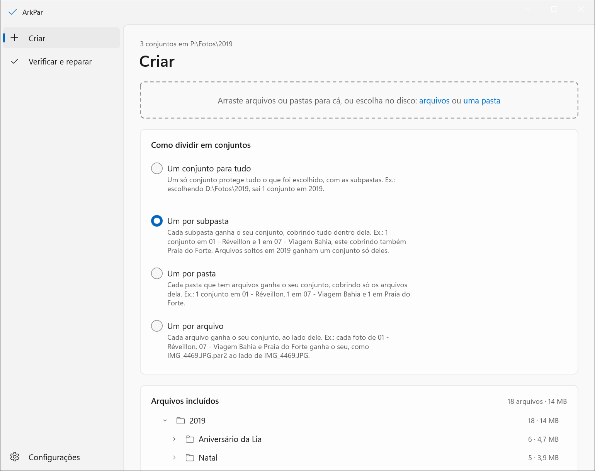
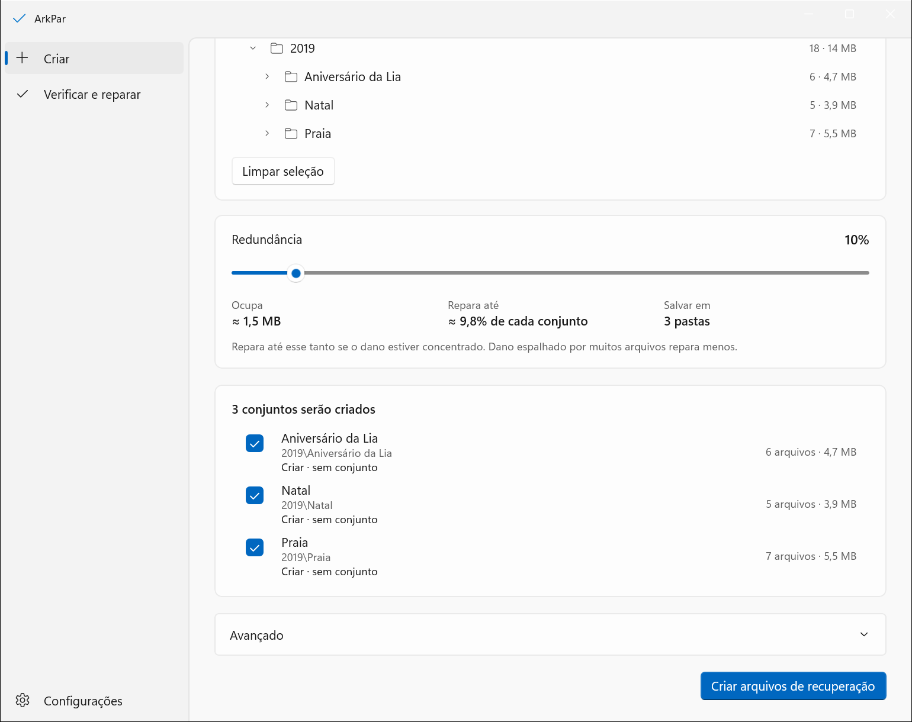
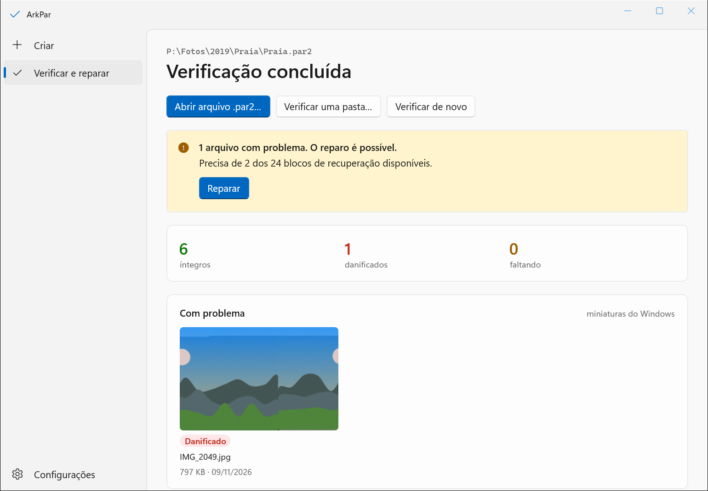

<p align="center">
  
</p>

<h1 align="center">ArkPar</h1>

<p align="center">
  <b>Protect your files today. Repair them when they break.</b><br>
  A simple Windows app that creates PAR2 recovery files, then verifies and repairs what they protect.
</p>

<p align="center">
  <b>English</b> · <a href="README.pt-BR.md">Português (Brasil)</a>
</p>

<p align="center">
  <a href="https://github.com/carreirodev/ArkPar/releases/latest"></a>
  
  
</p>

<p align="center">
  
</p>

## What it does

Disks fail quietly. A photo you saved years ago can come back with a grey stripe across it, or not open at all, and a plain backup copies the damage along with everything else.

ArkPar gives your files a way back:

1. **Create.** Choose a folder. ArkPar writes a few extra files next to yours, the recovery files (`.par2`). By default they take about 10% of the size of what they protect.
2. **Verify.** Any time later, ArkPar reads everything again and tells you which files are intact, damaged, missing or renamed.
3. **Repair.** If something broke, ArkPar rebuilds it from the recovery files, byte for byte.

It was made for photo collections, and it works for any kind of file.

> [!NOTE]
> The app's screens are in Brazilian Portuguese. This page gives the name of each button as it appears on screen, with its meaning in English.

## Download and open

1. Download **`ArkPar-win-x64.zip`** from the [latest release](https://github.com/carreirodev/ArkPar/releases/latest).
2. Right-click the zip, choose **Extract All…**, and keep the `ArkPar` folder wherever you like. Do not run it from inside the zip.
3. Open the `ArkPar` folder and double-click **`ArkPar.exe`**.

Nothing needs installing: everything ArkPar uses is inside that folder. To remove it, delete the folder.

**Requirements:** Windows 11, 64-bit.

### The Windows warning on first run

ArkPar is not digitally signed, so Windows may show a warning the first time you open it:

- **"Windows protected your PC"**: click **More info**, then **Run anyway**.
- **"Open File - Security Warning"**: click **Run**.
- **Smart App Control blocked it, with no button to run**: Windows will not open unsigned apps while Smart App Control is on, and it cannot be allowed for one app alone. `LEIA-ME.txt` in the package explains the choice you have.

You can check your download against the SHA-256 printed in the release notes:

```powershell
Get-FileHash .\ArkPar-win-x64.zip -Algorithm SHA256
```

## How to use it

### Create recovery files

Open **Criar** (Create), then drag files or folders into the window, or pick them from the disk.

**Como dividir em conjuntos** (how to split into recovery sets) decides how many sets come out. A recovery set is the group of `.par2` files that protects one fixed list of files.

| On screen | Meaning | Example: choosing `D:\Fotos\2019` |
| --- | --- | --- |
| **Um conjunto para tudo** | One set for everything, subfolders included | 1 set in `2019` |
| **Um por subpasta** | One set for each direct subfolder | 1 set in `2019\Praia`, 1 in `2019\Natal` |
| **Um por pasta** | One set in every folder that holds files, at any depth | 1 set in each folder, covering only its own files |
| **Um por arquivo** | One set for each file | 1 set per photo |

**Redundância** (redundancy) is how much damage the set can undo, on a slider from 1% to 100%. The screen shows what that buys before you commit: **Ocupa** (the disk space the recovery files take) and **Repara até** (how much damage they can repair). At 10%, a 20 GB folder gets about 2 GB of recovery files and survives the loss of about 2 GB of its content.

<p align="center">
  
</p>

Click **Criar arquivos de recuperação** (create recovery files). You can pause, resume or cancel while it works. When it ends with the window minimized, a Windows notification tells you how it went.

Creating again in a folder that already has a set is safe: the set already there stays untouched until the new one is complete.

### Verify and repair

Open **Verificar e reparar** (Verify and repair).

- **Abrir arquivo .par2…** verifies one recovery set.
- **Verificar uma pasta…** verifies every recovery set inside a folder, at any depth, and sums them up by folder: intact, with a problem that can be repaired, with a problem that cannot, or not verified.

<p align="center">
  
</p>

ArkPar lists each file as **íntegro** (intact), **danificado** (damaged), **faltando** (missing) or **nome trocado** (renamed). When the set holds enough recovery data, **Reparar** (Repair) rebuilds the files; in a folder verification, **Reparar todas as reparáveis** repairs every folder that can be repaired. A damaged file that gets replaced goes to the Recycle Bin, not straight to deletion.

You can also double-click any `.par2` file in Explorer to verify its set. ArkPar offers this the first time it opens, and **Configurações** (Settings) turns it on or off.

### Settings

**Configurações** holds what every task uses: whether to use the graphics card (GPU) to go faster, how many processor cores to use, and whether `.par2` files open with ArkPar.

## Good to know

- **Recovery has a limit, and you choose it.** A set made at 10% redundancy repairs up to about 10% of what it protects. If more than that is lost, ArkPar says the set cannot repair it. For files you cannot lose, use more redundancy, and keep a backup as well: ArkPar complements a backup, it does not replace one.
- **A set knows only the files that existed when it was created.** After adding, editing or removing files, create the set again: the list before creating shows which sets no longer match their files.
- **Keep the `.par2` files with what they protect.** They travel with the folder, so copy them along to the external drive or the cloud.
- **One set protects up to 32,768 files.** For bigger collections, pick a mode that makes more than one set, such as **Um por subpasta**.
- **Your files are never locked in.** PAR2 is an open format that has not changed since 2003. Recovery files made by ArkPar open in any other PAR2 program (MultiPar, par2cmdline, QuickPar), and ArkPar verifies and repairs sets made by them.
- **PAR3 is not supported yet.** Its specification is still a draft, and files made with it today may not open in the future. ArkPar will adopt it when it is stable.

## How it works

ArkPar is a fork of [MultiPar](https://github.com/Yutaka-Sawada/MultiPar) by Yutaka Sawada. It has two parts:

- **The engine**, `par2j64.exe`, does all the PAR2 work. It is MultiPar's own engine, built from the unmodified source in [`source/par2j`](source/par2j).
- **The app**, in [`app/`](app), is new: a WinUI 3 interface written in C# on .NET 10 that drives the engine and shows what it finds.

Why this design was chosen is recorded in [`docs/adr/`](docs/adr), and the vocabulary used across the project in [`GLOSSARY.md`](GLOSSARY.md).

## Build from source

You need Windows 11 (64-bit), the .NET 10 SDK and Visual Studio Build Tools 2026 with the C++ desktop workload.

```powershell
pwsh -File app/build-engine.ps1
```

```powershell
dotnet test app/ArkPar.slnx
```

```powershell
dotnet run --project app/src/ArkPar.App
```

To build the same zip the releases carry:

```powershell
pwsh -File app/build-package.ps1
```

[`app/README.md`](app/README.md) has the details.

## Credits and license

- The PAR2 engine and MultiPar were written by **Yutaka Sawada**. ArkPar would not exist without that work. The `source/` and `alpha/` folders are MultiPar's, kept unchanged.
- ArkPar's app is developed by **WPC Solutions**.

ArkPar is free software under the **GNU General Public License, version 2 or later** (GPL-2.0-or-later), and comes with no warranty. The package carries the full license texts, including those of the .NET runtime and the Windows App SDK that ship inside it; [`app/README.md`](app/README.md) states the additional permission that allows shipping them together.
