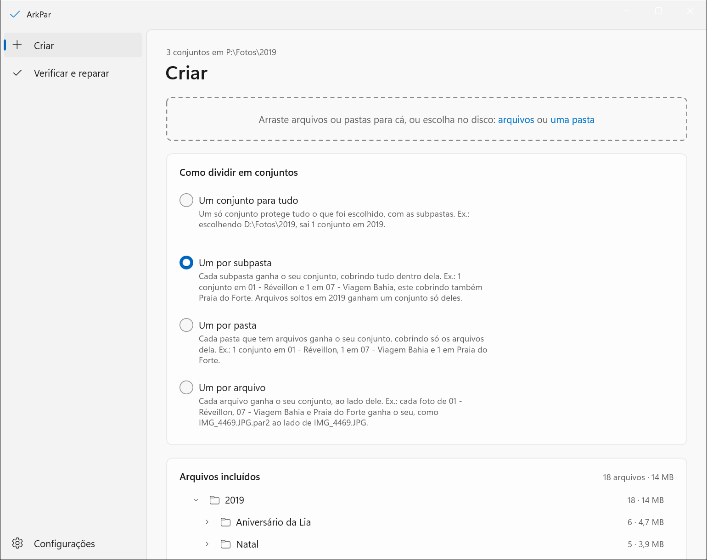
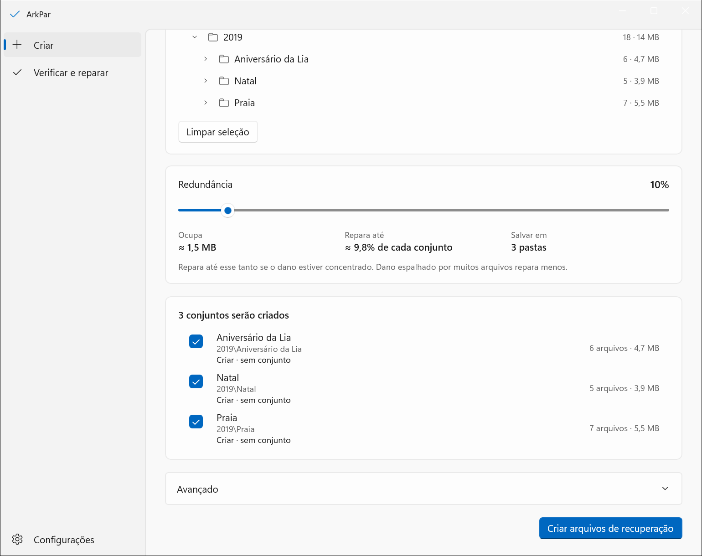
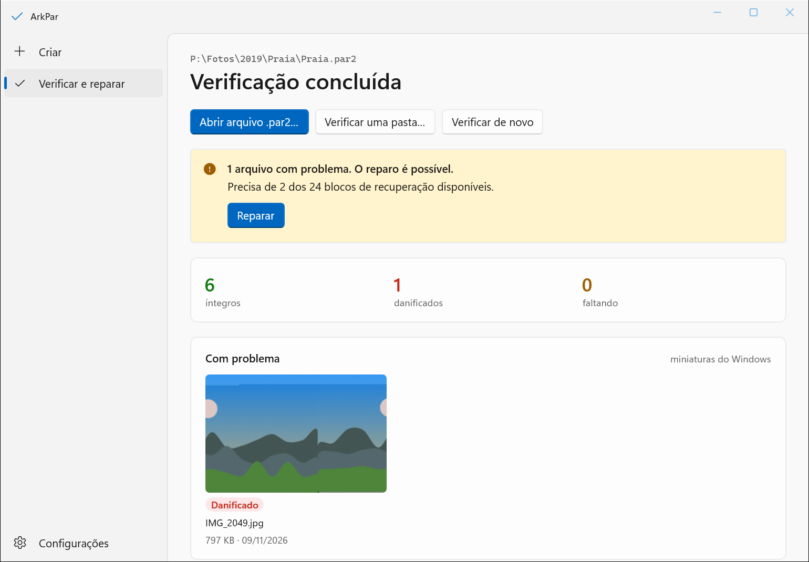

<p align="center">
  
</p>

<h1 align="center">ArkPar</h1>

<p align="center">
  <b>Proteja seus arquivos hoje. Repare quando estragarem.</b><br>
  Um app simples para Windows que cria arquivos de recuperação PAR2 e depois verifica e repara o que eles protegem.
</p>

<p align="center">
  <a href="README.md">English</a> · <b>Português (Brasil)</b>
</p>

<p align="center">
  <a href="https://github.com/carreirodev/ArkPar/releases/latest"></a>
  
  
</p>

<p align="center">
  
</p>

## O que ele faz

Discos falham em silêncio. Uma foto guardada há anos pode voltar com uma faixa cinza no meio, ou nem abrir, e um backup comum copia o estrago junto com todo o resto.

O ArkPar dá aos seus arquivos um caminho de volta:

1. **Criar.** Escolha uma pasta. O ArkPar grava alguns arquivos a mais ao lado dos seus, os arquivos de recuperação (`.par2`). Por padrão eles ocupam cerca de 10% do tamanho do que protegem.
2. **Verificar.** Quando quiser, o ArkPar lê tudo de novo e diz quais arquivos estão íntegros, danificados, faltando ou com o nome trocado.
3. **Reparar.** Se algo estragou, o ArkPar reconstrói o arquivo a partir dos arquivos de recuperação, byte por byte.

Ele foi feito pensando em coleções de fotos e funciona com qualquer tipo de arquivo.

## Baixar e abrir

1. Baixe o **`ArkPar-win-x64.zip`** da [última versão](https://github.com/carreirodev/ArkPar/releases/latest).
2. Clique no zip com o botão direito, escolha **Extrair tudo…** e guarde a pasta `ArkPar` onde preferir. Não abra o app de dentro do zip.
3. Abra a pasta `ArkPar` e dê dois cliques em **`ArkPar.exe`**.

Não é preciso instalar nada: tudo o que o ArkPar usa está dentro dessa pasta. Para tirá-lo do computador, apague a pasta.

**Requisitos:** Windows 11, 64 bits.

### O aviso do Windows na primeira vez

O ArkPar não é assinado digitalmente, então o Windows pode mostrar um aviso na primeira vez que você abrir:

- **"O Windows protegeu o computador"**: clique em **Mais informações** e depois em **Executar assim mesmo**.
- **"Abrir Arquivo - Aviso de Segurança"**: clique em **Executar**.
- **O Controle Inteligente de Aplicativos bloqueou, sem botão para executar**: o Windows não abre apps sem assinatura enquanto esse controle estiver ligado, e não há como liberar um app só. O `LEIA-ME.txt` do pacote explica a escolha que você tem.

Você pode conferir o download com o SHA-256 que aparece nas notas da versão:

```powershell
Get-FileHash .\ArkPar-win-x64.zip -Algorithm SHA256
```

## Como usar

### Criar arquivos de recuperação

Abra **Criar** e arraste arquivos ou pastas para a janela, ou escolha no disco.

**Como dividir em conjuntos** decide quantos conjuntos saem. Um conjunto de recuperação é o grupo de arquivos `.par2` que protege uma lista fixa de arquivos.

| Na tela | O que faz | Exemplo: escolhendo `D:\Fotos\2019` |
| --- | --- | --- |
| **Um conjunto para tudo** | Um conjunto só para tudo, com as subpastas | 1 conjunto em `2019` |
| **Um por subpasta** | Um conjunto para cada subpasta direta | 1 conjunto em `2019\Praia`, 1 em `2019\Natal` |
| **Um por pasta** | Um conjunto em cada pasta que tem arquivos, em qualquer nível | 1 conjunto em cada pasta, cobrindo só os arquivos dela |
| **Um por arquivo** | Um conjunto para cada arquivo | 1 conjunto por foto |

**Redundância** é quanto dano o conjunto consegue desfazer, num controle deslizante de 1% a 100%. A tela mostra o resultado antes de você confirmar: **Ocupa** (o espaço em disco dos arquivos de recuperação) e **Repara até** (quanto dano eles reparam). Com 10%, uma pasta de 20 GB ganha cerca de 2 GB de arquivos de recuperação e sobrevive à perda de cerca de 2 GB do conteúdo.

<p align="center">
  
</p>

Clique em **Criar arquivos de recuperação**. Dá para pausar, continuar ou cancelar enquanto ele trabalha. Se terminar com a janela minimizada, uma notificação do Windows conta como foi.

Criar de novo numa pasta que já tem um conjunto é seguro: o conjunto que já está lá fica intacto até o novo estar completo.

### Verificar e reparar

Abra **Verificar e reparar**.

- **Abrir arquivo .par2…** verifica um conjunto de recuperação.
- **Verificar uma pasta…** verifica todos os conjuntos dentro de uma pasta, em qualquer nível, e resume por pasta: íntegras, com problema reparável, com problema sem reparo ou não verificadas.

<p align="center">
  
</p>

O ArkPar lista cada arquivo como **íntegro**, **danificado**, **faltando** ou **nome trocado**. Quando o conjunto tem dados de recuperação suficientes, **Reparar** reconstrói os arquivos; na verificação de uma pasta, **Reparar todas as reparáveis** repara todas as pastas que têm conserto. O arquivo danificado que é substituído vai para a Lixeira, não é apagado direto.

Você também pode dar dois cliques em qualquer arquivo `.par2` no Explorer para verificar o conjunto. O ArkPar oferece isso na primeira vez que abre, e **Configurações** liga ou desliga.

### Configurações

**Configurações** guarda o que toda tarefa usa: se a placa de vídeo (GPU) ajuda a acelerar, quantos núcleos do processador usar e se os arquivos `.par2` abrem com o ArkPar.

## Bom saber

- **A recuperação tem um limite, e é você quem escolhe.** Um conjunto criado com 10% de redundância repara até cerca de 10% do que protege. Se o estrago for maior, o ArkPar avisa que o conjunto não consegue reparar. Para arquivos que você não pode perder, use mais redundância e mantenha também um backup: o ArkPar complementa o backup, não substitui.
- **O conjunto só conhece os arquivos que existiam quando foi criado.** Depois de adicionar, editar ou remover arquivos, crie o conjunto de novo: a lista antes de criar mostra quais conjuntos não batem mais com os arquivos.
- **Guarde os arquivos `.par2` junto com o que eles protegem.** Eles viajam com a pasta, então copie tudo junto para o HD externo ou para a nuvem.
- **Um conjunto protege até 32.768 arquivos.** Para coleções maiores, escolha um modo que faça mais de um conjunto, como **Um por subpasta**.
- **Seus arquivos nunca ficam presos ao ArkPar.** O PAR2 é um formato aberto que não muda desde 2003. Os arquivos de recuperação criados pelo ArkPar abrem em qualquer outro programa PAR2 (MultiPar, par2cmdline, QuickPar), e o ArkPar verifica e repara conjuntos criados por eles.
- **O PAR3 ainda não é suportado.** A especificação dele ainda é um rascunho, e arquivos criados com ela hoje podem não abrir no futuro. O ArkPar vai adotá-lo quando estiver estável.

## Como funciona

O ArkPar é um fork do [MultiPar](https://github.com/Yutaka-Sawada/MultiPar), de Yutaka Sawada. Ele tem duas partes:

- **O motor**, `par2j64.exe`, faz todo o trabalho com PAR2. É o motor do próprio MultiPar, compilado do código-fonte sem modificações em [`source/par2j`](source/par2j).
- **O app**, em [`app/`](app), é novo: uma interface WinUI 3 escrita em C# sobre .NET 10, que comanda o motor e mostra o que ele encontra.

O porquê desse desenho está registrado em [`docs/adr/`](docs/adr), e o vocabulário do projeto em [`GLOSSARY.md`](GLOSSARY.md) (ambos em inglês).

## Compilar do código-fonte

Você precisa do Windows 11 (64 bits), do .NET 10 SDK e do Visual Studio Build Tools 2026 com a carga de trabalho de C++ para desktop.

```powershell
pwsh -File app/build-engine.ps1
```

```powershell
dotnet test app/ArkPar.slnx
```

```powershell
dotnet run --project app/src/ArkPar.App
```

Para montar o mesmo zip das versões publicadas:

```powershell
pwsh -File app/build-package.ps1
```

Os detalhes estão em [`app/README.md`](app/README.md) (em inglês).

## Créditos e licença

- O motor PAR2 e o MultiPar foram escritos por **Yutaka Sawada**. O ArkPar não existiria sem esse trabalho. As pastas `source/` e `alpha/` são do MultiPar e ficam sem alterações.
- O app do ArkPar é desenvolvido pela **WPC Solutions**.

O ArkPar é software livre sob a **GNU General Public License, versão 2 ou posterior** (GPL-2.0-or-later), e é distribuído sem nenhuma garantia. O pacote traz os textos completos das licenças, incluindo os do .NET e do Windows App SDK que vão dentro dele; o [`app/README.md`](app/README.md) registra a permissão adicional que permite distribuí-los juntos.
